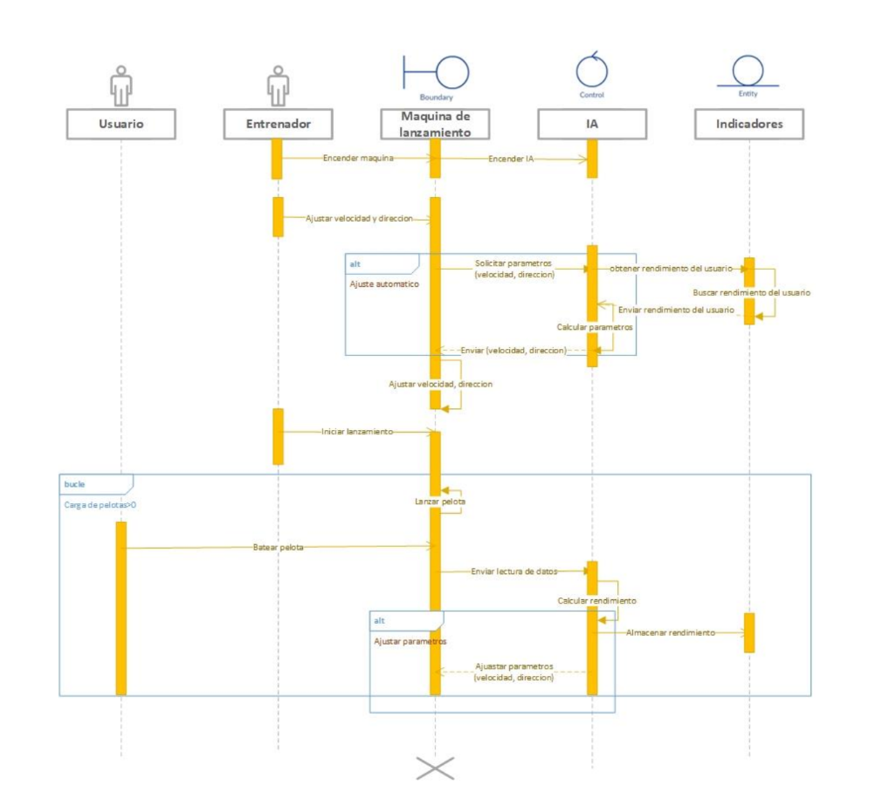

#  Diseño del software y modelado del sistema
Hay acciones síncronas donde necesitamos establecer que un proceso depende de otro. En cambio hay acciones que se realizan de manera secuencial.

Las bases de datos relacionales se muestran con diagramas de tablas.

El diagrama que le sigue al de actividades es el siguiente:

